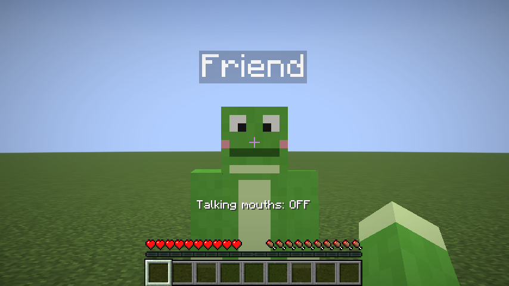

# Player Characters

A client-side Fabric mod for **Minecraft 1.21.11**. It shows players on a server as characters you make
yourself, and their character's mouth opens and closes while they talk in
[Simple Voice Chat](https://modrinth.com/plugin/simple-voice-chat).

| Another player talking | Automatic mouth | Talking mouths turned off (U) |
|---|---|---|
|  |  |  |

| Character menu (K) | Choosing a character | Key binds |
|---|---|---|
|  |  |  |

## Install

1. Install [Fabric Loader](https://fabricmc.net/use/) 0.20.1 or newer for Minecraft 1.21.11.
2. Put these in your `.minecraft/mods` folder:
   - `player-characters-1.0.0.jar` (this mod), from the [Releases page](https://github.com/itamarbleiberg/buti/releases)
   - [Fabric API](https://modrinth.com/mod/fabric-api) for 1.21.11
   - [Simple Voice Chat](https://modrinth.com/plugin/simple-voice-chat) for Fabric 1.21.11 (needed for the talking mouths;
     the server must have Simple Voice Chat too, as usual)

The server does **not** need this mod. Characters are only shown on your screen: other players keep seeing
normal skins unless they install the mod and set it up themselves.

## Use

| Key (default) | What it does |
|---|---|
| **K** | Open the character menu |
| **U** | Turn talking mouths on/off |

Change the keys in **Options > Controls > Key Binds > Player Characters**.

In the character menu:

- Every player on the server is listed (you are first). Click the button next to a player to pick their
  character. The picker shows a 3D preview (drag it to rotate) with the mouth opening and closing.
- **Default** decides what everyone you haven't picked for looks like: their own skin, a random character
  (each player always gets the same one), or one specific character.
- **Talking mouths** does the same as the U key.
- **Characters folder** opens the folder with your characters. **Reload** loads new or changed files.

Your choices are saved in `.minecraft/config/playercharacters.json`.

## Making characters

Characters live in `.minecraft/config/playercharacters/characters/`. The first start creates the folder with
two examples (Robot and Frog) and a `README.txt`.

- `Name.png`: a normal 64x64 Minecraft skin (old 64x32 skins work too). Every PNG is one character, and the
  file name is its name. Slim (3-pixel) arms are detected automatically.
- `Name_talking.png` (optional): the same skin with the mouth drawn open, shown while that player talks.
  Without it, the mod draws an open mouth on the face for you.
- `Name.json` (optional): settings, for example

  ```json
  {
    "name": "Frog",
    "model": "slim",
    "mouth": { "x": 1, "y": 5, "width": 6, "height": 2 }
  }
  ```

  `mouth` moves the automatic mouth. It is measured in pixels on the 8x8 face, from the top-left corner.
  The default (x 3, y 6, width 2, height 2) fits most skins.

## How it works

- `AbstractClientPlayerMixin` swaps the skin that players in the world are drawn with (including first-person
  arms and the inventory preview). The tab list and menus keep real skins so you can tell who is who.
  Characters hide the player's real cape.
- `VoiceChatPlugin` is a Simple Voice Chat client plugin. It receives the audio of nearby players, group chat
  and your own microphone, and `TalkTracker` opens the mouth on the loud parts of speech (syllables) and closes
  it in the quieter gaps, relative to how loud that person usually is.
- Without Simple Voice Chat installed, the mod still works; mouths just don't move.

## Building from source

Gradle must run on **Java 25** (required by Fabric Loom 1.19); the mod itself targets Java 21 like Minecraft 1.21.11.

```
./gradlew build
```

The jar ends up in `build/libs/`.

`./gradlew runClientGameTest` starts the game, creates a world and checks the mod end to end (example
characters, skins on another player, talking mouths, both keys, the menus), saving screenshots to
`build/run/clientGameTest/screenshots/`. If Simple Voice Chat is added to the test game, it also plays real
voice chat audio and checks that mouths react to it.
