# Player Characters

A client-side Fabric mod for **Minecraft 1.21.11**. It shows players on a server as characters you choose: 3D
characters or skins you make yourself. The mod comes with ten 3D characters: an Alien, a Robot, a Frog, a Burger, a
smoking Penguin, SpongeBob, a Skinny Alien, 67, the **White Queen** (a chess queen with a sniper rifle) and the
**Black Wolf** (three tails with blue flames, walking on four legs).

- Mouths open while players talk in [Simple Voice Chat](https://modrinth.com/plugin/simple-voice-chat).
- Press **B** for the emote wheel: 32 emotes like the Default Dance, the 67, the Floss and the Griddy. You can walk,
  run and jump while you dance; sneaking stops the emote. You can give the dances your own music.
- Farting and the middle finger are on the wheel too, or type "fart", "fuck you" or "fuck off" in chat.
- Players who have the mod see your character and your emotes, and you see theirs.
- In first person you see your character's own arm, your middle finger, and a green screen when you fart.

While a player is shown as a character, you don't see their armor, but you still see their name tag and (except for
the queen and the wolf) the item they're holding.

| White Queen | Her rifle follows where she looks | Black Wolf | At night its eyes, runes and flames glow |
|---|---|---|---|
| 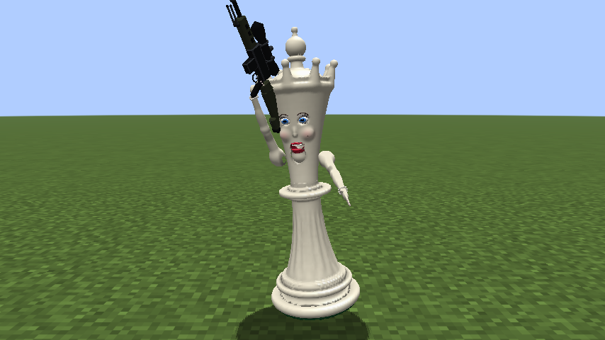 | 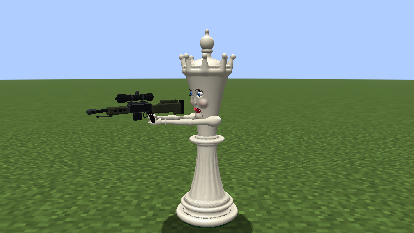 | 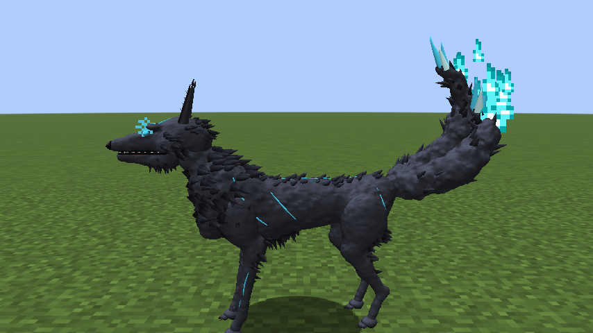 | 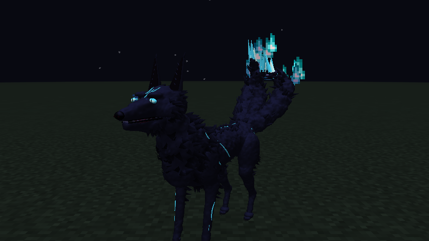 |

| Emote wheel (B) | The pictures show your own character | Walking while dancing | The wolf stands up to dance |
|---|---|---|---|
| 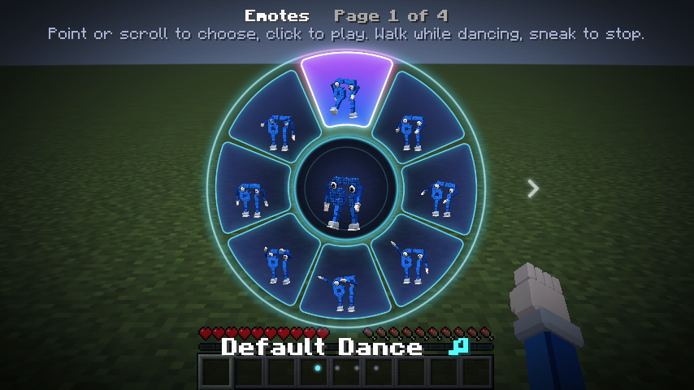 | 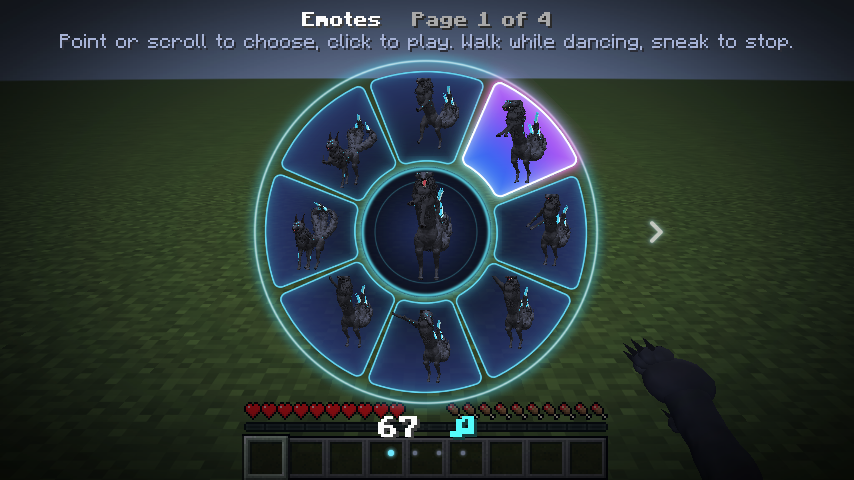 | 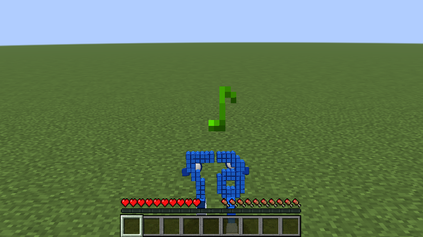 | 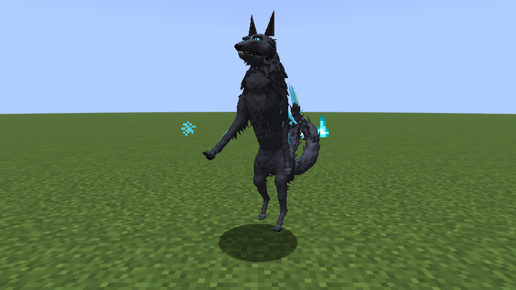 |

| Default Dance | Griddy | 67 | Jumping Jacks |
|---|---|---|---|
| 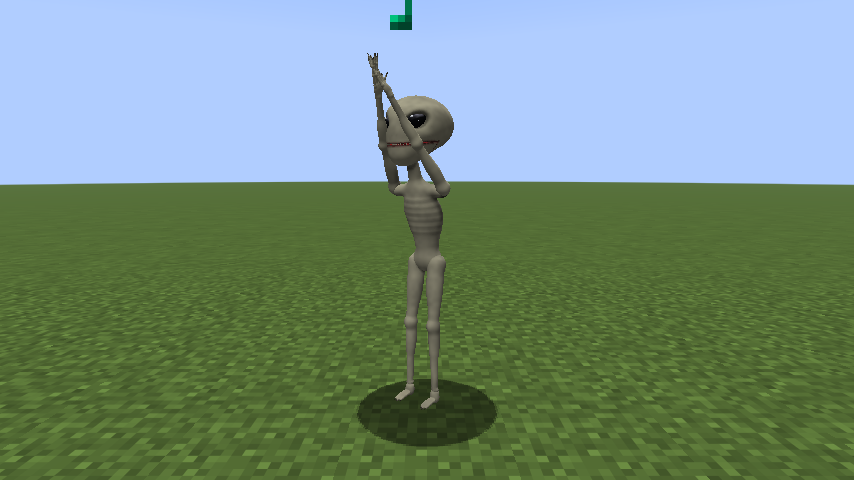 | 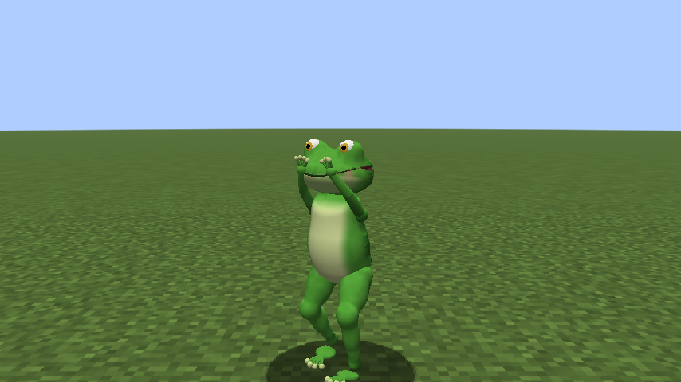 | 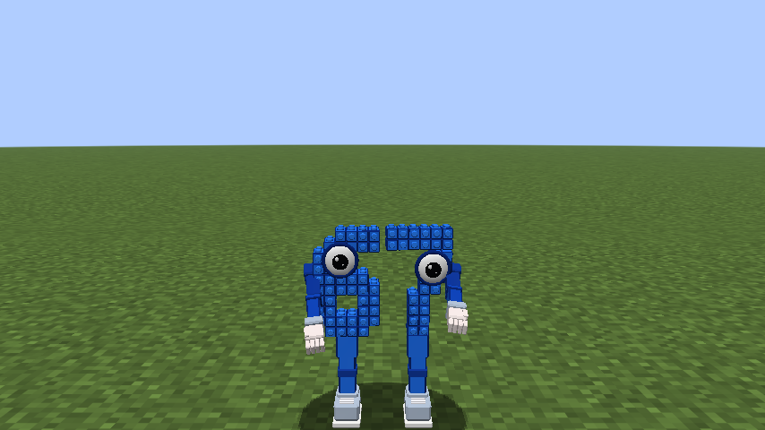 | 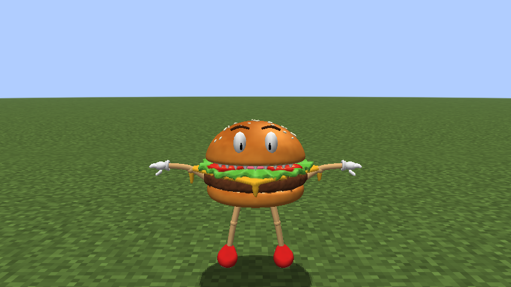 |

| First person: your own arm | The queen's arm and rifle | The wolf's paw | Your middle finger |
|---|---|---|---|
|  | 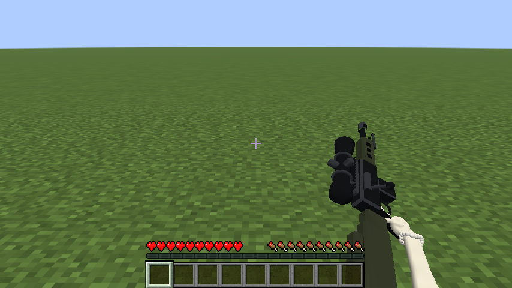 | 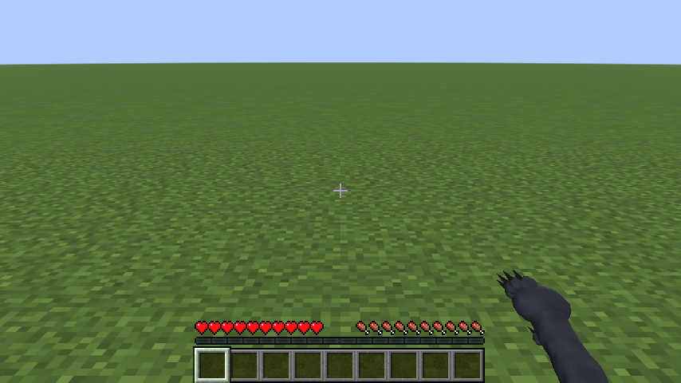 |  |

| Penguin | SpongeBob | Skinny Alien | 67 |
|---|---|---|---|
|  |  |  |  |

These four are saying "fuck you".

| The penguin smokes | Robot talking | Frog talking | Burger talking (its top bun is the mouth) |
|---|---|---|---|
|  |  |  |  |

| Farting | | | In first person your screen turns green |
|---|---|---|---|
|  |  |  |  |

| Middle finger with a normal skin | Robot | Burger |
|---|---|---|
|  |  |  |

| Alien from the side, holding a sword | Normal player in armor | Same player as a skin character (armor hidden) |
|---|---|---|
|  |  |  |

| Character menu (K) | Choosing a character | Key binds |
|---|---|---|
|  |  |  |

## Install

1. Install [Fabric Loader](https://fabricmc.net/use/) 0.20.1 or newer for Minecraft 1.21.11.
2. Put these in your `.minecraft/mods` folder:
   - `player-characters-7.0.0.jar` (this mod), from the [Releases page](https://github.com/itamarbleiberg/buti1/releases)
   - [Fabric API](https://modrinth.com/mod/fabric-api) for 1.21.11
   - [Simple Voice Chat](https://modrinth.com/plugin/simple-voice-chat) for Fabric 1.21.11 (optional: needed for
     talking mouths; the server must have Simple Voice Chat too, as usual)

The server does **not** need this mod. Players who don't have it see normal players and read your emotes as chat
messages. Players who have it see each other's characters and emotes (see
[Seeing each other's characters](#seeing-each-others-characters)).

Remove older versions of `player-characters-*.jar` from the mods folder first: two versions of the same mod don't load.

## Use

| Key (default) | What it does |
|---|---|
| **K** | Open the character menu |
| **U** | Turn talking mouths on/off |
| **B** | Open the emote wheel |

Change the keys in **Options > Controls > Key Binds > Player Characters**.

In the character menu:

- Every player on the server is listed (you are first). Click the button next to a player to pick their
  character. The picker shows your own player as the highlighted character, with its mouth opening and closing.
  What you pick for yourself is what other players with the mod see you as.
- **Default** decides what everyone you haven't picked for looks like: their own skin, a random character
  (each player always gets the same one), or one specific character.
- **Talking mouths** does the same as the U key.
- **Farts** and **Middle finger** turn those emotes on or off, for everyone you see.
- **Emote music** turns the dances' music on or off (its volume is "Jukebox/Note Blocks" in the sound settings).
- **Share with players** decides whether your emotes and your character are told to the other players, and
  **Their own picks** whether players who have the mod are shown as the character they picked for themselves (see
  below). A player who did that has "Their pick: ..." on their button.
- **Characters folder** opens the folder with your characters, **Music folder** the one for your own emote music.
  **Reload** loads new or changed files.

Your choices are saved in `.minecraft/config/playercharacters.json`.

## Emote wheel

Press **B** (or hold it). The wheel shows 8 emotes at a time, on 4 pages. Each picture is your own character in that
emote, and the middle shows your character doing the highlighted one:

- Point the mouse at an emote, or scroll: scrolling past the last one of a page goes to the next page. The arrow keys,
  the number keys 1 to 8 and the **<** **>** buttons work too.
- Click (or press Enter) to play it. If you held B down while choosing, letting go of B plays it. Esc or a right click
  closes the wheel.

| Page 1 | Page 2 | Page 3 | Page 4 |
|---|---|---|---|
| Default Dance, 67, Floss, Wave, Dab, Griddy, Fart, Middle Finger | Clap, Salute, Facepalm, Laugh, Cry, Bow, Shrug, Think | Jumping Jacks, Spin, Chicken Dance, Robot, Disco, Air Guitar, Headbang, Hype | Flex, Push-Ups, Sit, Zombie, L Dance, Heart, Blow a Kiss, Cheer |

- **You can walk, run and jump during an emote.** The legs walk while the arms keep dancing, except in emotes that
  use the legs themselves (the Griddy, Sit and Push-Ups).
- **Sneaking stops the emote.** So do swimming, flying with an elytra, sleeping, riding, attacking and using an item.
- Dances repeat for up to a minute; the others play once.
- In first person the camera turns around to watch your character from the front. When you start walking it moves
  behind you, so you can see where you're going, and afterwards it goes back to first person. If you change the
  camera yourself (F5), it's left the way you set it.
- The Default Dance, the Floss, the Griddy and Hype follow the moves of the Fortnite emotes: the Default Dance steps with
  pumping fists, throws both arms up, slams them down, points and crosses its arms, and the Griddy taps its heels with
  its hands around its eyes like goggles.
- Dances play a short note block tune and music notes float up; some emotes have hearts, tears or sparkles.

Every emote works for 3D characters, skin characters and normal skins. The wolf stands up on its back legs for
emotes and uses its front legs as arms.

### Your own music

The mod can't include music from Fortnite or other games: those songs are copyrighted, and this repository is
public. Instead, any emote can play a music file you put in the **Music folder**
(`.minecraft/config/playercharacters/music/`):

- Name the file after the emote, like `Default Dance.ogg`, `Griddy.ogg` or `Floss.ogg` (the folder has a
  `README.txt` with all the names). It plays instead of that emote's note block tune, and dances repeat it.
- Only Ogg Vorbis (`.ogg`) works. Convert MP3 or WAV files first, for example with [Audacity](https://www.audacityteam.org/).
- New files are noticed within a few seconds. The volume is "Jukebox/Note Blocks" in the sound settings.
- The music plays for whoever you see doing that emote. Other players hear the files in their own music folder,
  not yours.

## Farts and the middle finger

- **Fart**: the character bends over, a green cloud puffs out of its butt and you hear a fart.
- **Middle finger**: the character points its right arm at whoever is in front of it and shows the middle finger,
  puts away what it holds in that hand, and looks mad for about 3 seconds (angry eyebrows, and an angry cloud above
  its head). Players in a normal skin get a finger and eyebrows added to the Minecraft model.

Play them from the emote wheel, or type the words in chat: "fart" for a fart, "fuck you" or "fuck off" for the middle
finger. They aren't started by talking anymore (version 6 listened for the words in voice chat; version 7 removed that
and deletes the 47 MB speech model it had unpacked in `.minecraft/playercharacters/speech-model`).

In first person you see it too: your fist comes up in front of you with the middle finger pointing at whoever you look
at, and when you fart your screen turns green while gas bubbles float up and pop.

## Seeing each other's characters

This mod only runs on clients, so it tells other players things through chat:

- When you join a server where someone else is online, and whenever you pick another character for yourself, it sends
  a `/me` message: "* Steve is playing as Black Wolf" (or "* Steve is using their own skin").
- Players who have the mod then see you as the Black Wolf, and their mod whispers back what they are playing as
  (`/msg Steve [Player Characters] Alex is playing as Frog`). Those whispers are hidden from the chat of players
  with the mod. Players without the mod just read the `/me` line.
- Playing an emote sends a `/me` message such as "* Steve does the Default Dance" (at most one every 2 seconds), and
  players with the mod see your character do it. Typing `/me waves` yourself works too.
- They need the same character: the ten that come with the mod work unless they deleted them. For characters you
  made, the other player needs one with the same name in their characters folder; otherwise they see what they picked
  for you.
- **Share with players** off: nothing is sent, and only you see your emotes. **Their own picks** off: you choose what
  everyone looks like, even players who picked a character for themselves.

## Characters

Characters live in `.minecraft/config/playercharacters/characters/`. The mod puts ten 3D examples there (the eight
older ones, the White Queen and the Black Wolf; 67 is in the folder `Blue`) and a `README.txt` with the details below.
The penguin smokes: a thin line of smoke rises from its cigarette (except in your own first-person view, where it
would be right in front of your eyes).

- **White Queen**: a white chess queen with a face, a crown and pearls, holding a sniper rifle with a scope. Both
  arms aim the rifle wherever she looks, and in first person you see the rifle in your hand. She doesn't show held
  items, because her hands are on the rifle.
- **Black Wolf**: a big black wolf with thick fur, a mane, glowing blue eyes and runes, and three tails that sway and
  burn with blue soul flames. It walks and runs on four legs, leaves dark mist when it sprints, and stands up on its
  back legs for emotes.

Upgrading: examples from older versions are updated (version 7 gives the eight older ones more detailed arms for first
person, and adds the queen and the wolf), and the version 2 skin Robot and Frog are replaced by the 3D ones. If you
changed any file of an example, that whole example is kept as it is, so a new model never gets old settings. Deleted
examples don't come back. If a skin and a 3D folder have the same name, the 3D one is used and the menu tells you which
file was skipped.

### 3D characters

A folder with a `model.obj`, like `Alien/`:

- `model.obj` (required): a Wavefront OBJ model, the format Blender and most 3D model sites can export.
  Use Y up, facing forward (+Z), 1 unit = 1 block. Split the model into objects named `head`, `jaw`, `body`,
  `right_arm`, `left_arm`, `right_leg` and `left_leg`. Each part moves like the same part of a normal player
  (walking, looking around, swinging, sneaking), and the `jaw` opens while the player talks.
  Objects with other names move with the body.
- Optional objects:
  - `mad_head` (or `mad_jaw`, `mad_body`...) is only drawn while the character is mad, `calm_head` and so on only
    while it isn't, and `middle_finger` is a right arm making the gesture, used instead of `right_arm`. Model it
    hanging down like `right_arm`, with the finger pointing forward: the emote raises the arm forward, which turns the
    finger up.
  - `blink_head` (or `blink_jaw`...) are closed eyelids: they show for a moment every few seconds.
  - `glow_head` (or `glow_body`...) glows in the dark, like the wolf's eyes and runes.
  - Objects whose names start with `tail` (`tail_left`, `tail_middle`...) sway by themselves, bending along their
    length: slowly while standing, faster while walking, and they wag during emotes. `glow_tail...` glows and sways
    with the tail of the same name.
  - `fp_right_arm`, `fp_left_arm` and `fp_middle_finger` are more detailed arms, only drawn in first person.
- `texture.png` (optional): the texture. Without it, the model's vertex colors are used.
- `character.json` (optional): `name`, `height` (in blocks), `size` (scale), `turn` (degrees, if the model faces
  the wrong way), `jaw_angle` (degrees; negative opens the jaw upward like a lid, as the Burger's bun does),
  `butt` (where the fart cloud comes out), `waddle` (degrees it rocks from side to side while walking),
  `head_turn` (0 to 1: how much of the player's looking around the head copies), `smoke` (where smoke rises from,
  moving with the head, like the tip of the penguin's cigarette), `bounce` (blocks the character bobs up and down with
  each step), and per-part `pivot` (the joint) and `hand` (where held items go). New in version 7:
  - `stance`: `"four_legs"` for animals. Then `right_arm`/`left_arm` are the front legs and `right_leg`/`left_leg`
    the back legs (`front_right_leg` and so on work as names too). They trot in diagonal pairs, and for emotes the
    character stands up on its back legs.
  - `arms`: `"rifle"` holds both arms out where the player looks, like aiming a rifle (model the rifle as part of
    `right_arm`).
  - `hide_held_items`: `true` doesn't show the items the player holds.
  - `particles`: a list of particles that keep coming out of the character, for example
    `{ "particle": "soul_fire_flame", "part": "tail_left", "every": 4 }`. `part` is the part they follow (a tail's
    tip by default), `at` a point in model coordinates, `every` the ticks between particles, `when` is `"always"`,
    `"moving"`, `"sprinting"` or `"still"`, and `spread` and `velocity` are in blocks. `"dust"` particles take a
    `color` (`"#5FE6FF"`) and `size`.
- Without pivots, they're guessed from each part's size. A part can have a pivot without being in the model:
  the Burger has only a head pivot, so its bun turns with the head.
- `icon.png` (optional): picture for the menu.

The ten examples were made for this mod by [`tools/CharacterModels.java`](tools/CharacterModels.java), which
sculpts them from mathematical shapes, so they can be changed and rebuilt
(`java tools/CharacterModels.java <folder> [previewFolder] [name]`). The fart sounds are synthesized by
[`tools/make_fart_sounds.py`](tools/make_fart_sounds.py), and the emote wheel's pictures are drawn by
[`tools/EmoteWheelTextures.java`](tools/EmoteWheelTextures.java).

### Skin characters

- `Name.png`: a normal 64x64 Minecraft skin (old 64x32 skins work too). The file name is its name.
  Slim (3-pixel) arms are detected automatically.
- `Name_talking.png` (optional): the same skin with the mouth drawn open, shown while that player talks.
  Without it, the mod draws an open mouth on the face for you.
- `Name.json` (optional): `name`, `model` (`slim`/`wide`) and `mouth` (where the automatic mouth goes on the
  8x8 face, e.g. `{ "x": 1, "y": 5, "width": 6, "height": 2 }`).

## What gets hidden

For every character: armor, elytra, and heads or pumpkins worn on the head. For 3D characters also capes,
stuck arrows and bee stingers, which would float next to a differently shaped body. Name tags, the Simple Voice
Chat speaker icon, held items (except for characters with `hide_held_items`), parrots and riptide effects still show.
In first person, a 3D character shows its own arm instead of Minecraft's (while your hand is empty, like Minecraft's
arm), drawn a bit bigger than on the character so the hand shows well; skin characters show their skin on it.

## How it works

- `AvatarRendererMixin` records on each player's render state which character to draw, how open its jaw is and
  how far it is bent over.
- `LivingEntityRendererMixin` draws the 3D model instead of the player model (copying the player model's pose
  each frame), leaves out the armor layers, and moves the held-item layer's hands onto the character's hands so
  Minecraft's own item code still handles bows, shields, spears and so on.
- `AbstractClientPlayerMixin` swaps the skin for skin characters.
- `VoiceChatPlugin` is a Simple Voice Chat client plugin. It receives the audio of nearby players, group chat
  and your own microphone. `TalkTracker` opens the mouth on the loud parts of speech (syllables) and closes it in
  the quieter gaps, relative to how loud that person usually is, and `JawAnimator` moves 3D jaws there smoothly.
- `FartEffects` and `MiddleFingerEmote` play the fart and the middle finger, started from the wheel or by the words in
  chat: `PlayerModelMixin` and `CharacterPoses` bend the upper body, raise the arm and make characters waddle, which
  3D characters, held items and the normal player model all follow. `VanillaEmoteParts` adds the finger and eyebrows
  to the normal player model.
- `EmotePlayer` plays emotes: `Emotes` has their animations, written as math (waves, and keyframes blended in
  seconds), and `CharacterPoses.emote` puts them on the player model, turning the head and arms with the body around
  the hips, and leaving the legs to walking while the player moves. Emotes that jump, spin, lie down or sit move the
  whole character where the renderer turns it (`AvatarRendererMixin`). `EmoteMusic` streams your own .ogg files
  through Fabric's sound API.
- `EmoteWheelScreen` is the wheel. `EmoteIconRenderer` draws each picture once, as your character frozen in that
  emote, into a texture that the wheel reuses.
- `EmoteChat` shares emotes as `/me` messages, and `CharacterSharing` tells other players with the mod what you
  are playing as, and listens for what they are playing as.
- Four-legged characters trot with `CharacterPoses.fourLegs`, and the queen aims with `CharacterPoses.rifle`.
  `TailMotion` bends tails vertex by vertex, glowing parts are drawn at full brightness, and `CharacterParticles`
  puts the particles from character.json where their parts are.
- 3D characters also blink, breathe, nod a little while talking and bob as they walk (`CharacterPoses`). Far away the
  renderer draws simpler copies of each model, made when it loads by merging nearby corners (`ModelDetail`): about a
  third of the polygons from 12 blocks, a fifth from 28.
- In first person, `AvatarRendererMixin` swaps in a 3D character's own arm, `ItemInHandRendererMixin` and
  `FirstPersonHands` draw it (and raise the middle finger) in front of the camera, and `FartScreen` is a HUD layer
  with the green screen and its bubbles. `CigaretteSmoke` puts smoke particles at the tip of the penguin's cigarette,
  following its head.
- Without Simple Voice Chat installed, the mod still works; mouths just don't move.

Other mods that replace the player model (Figura, Entity Model Features and similar) may not work together with
this one.

## Building from source

Gradle must run on **Java 25** (required by Fabric Loom 1.19); the mod itself targets Java 21 like Minecraft 1.21.11.

```
./gradlew build
```

The jar ends up in `build/libs/`.

`./gradlew runClientGameTest` starts the game, creates a world and checks the mod end to end (the ten example
characters, a skin character on another player in armor, talking jaws, farts and middle fingers typed in chat, the
penguin's smoke, the wolf trotting, standing up for emotes and its flames, the queen aiming, your own arm, middle
finger and green screen in first person, 17 emotes on other players, walking during emotes and sneaking to stop them,
the emote wheel and its pictures, your own music, sharing characters through chat, blinking, the simpler far-away
copies, all three keys, the menus, upgrading folders from versions 2 to 6), saving screenshots to
`build/run/clientGameTest/screenshots/`. If Simple Voice Chat is added to the test game, it also plays real voice
chat audio and checks that mouths react to it.
