# Player Characters

A client-side Fabric mod for **Minecraft 1.21.11**. It shows players on a server as characters you choose: 3D
characters (the mod comes with an Alien, a Robot, a Frog, a Burger, a smoking Penguin, SpongeBob, a Skinny Alien and
67) or skins you make yourself. The character's mouth opens while that player talks in
[Simple Voice Chat](https://modrinth.com/plugin/simple-voice-chat). When someone says "fart", their character bends
over and farts, and when they say "fuck you" or "fuck off", it shows the middle finger and looks mad for a few seconds.
In first person you see your character's own arm, your middle finger, and a green screen when you fart.

While a player is shown as a character, you don't see their armor, but you still see their name tag and the item
they're holding.

| Penguin | SpongeBob | Skinny Alien | 67 |
|---|---|---|---|
| 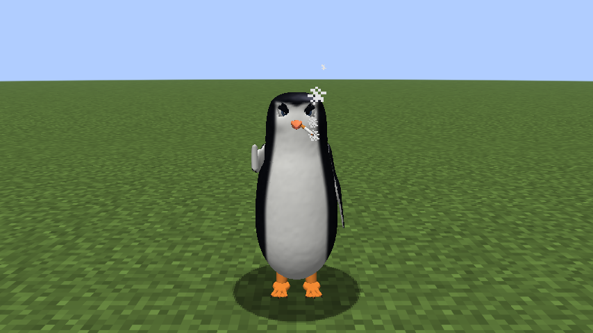 | 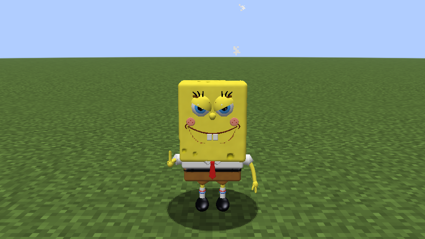 | 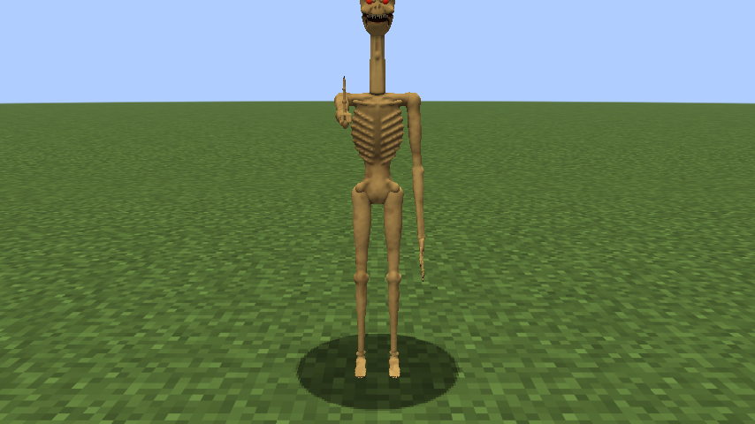 | 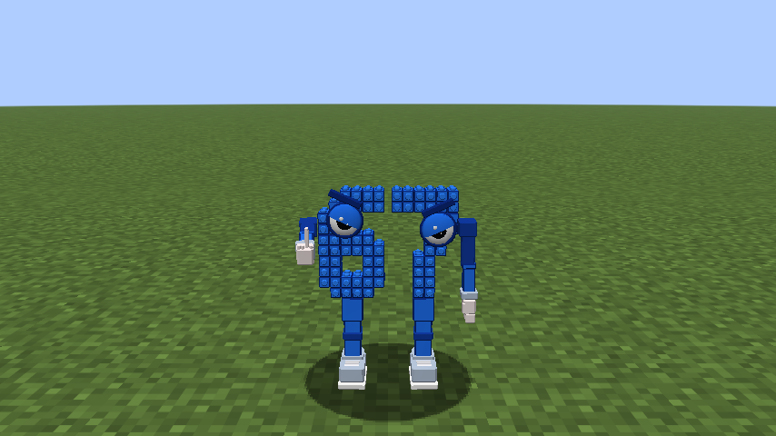 |

These four are saying "fuck you".

| The penguin smokes | First person: your own arm | Your middle finger | Farting turns your screen green |
|---|---|---|---|
| 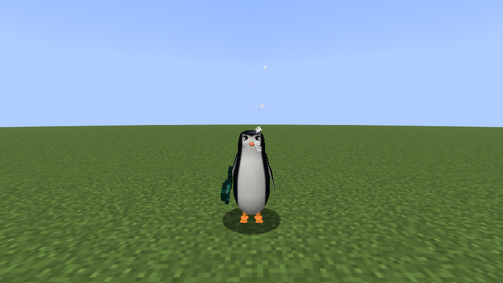 | 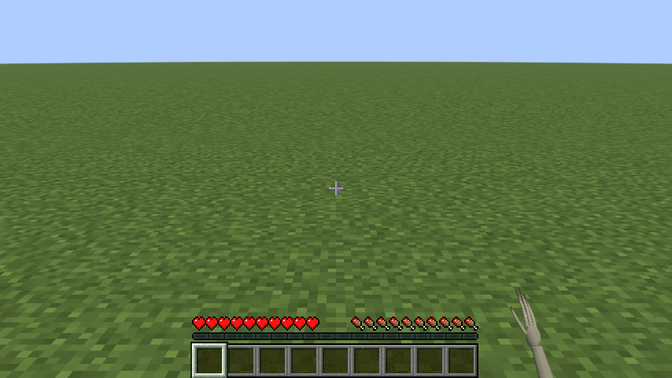 | 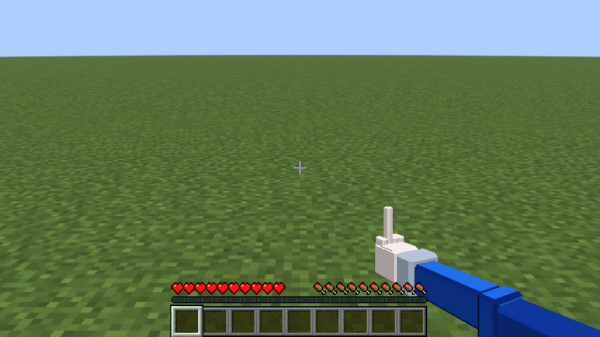 | 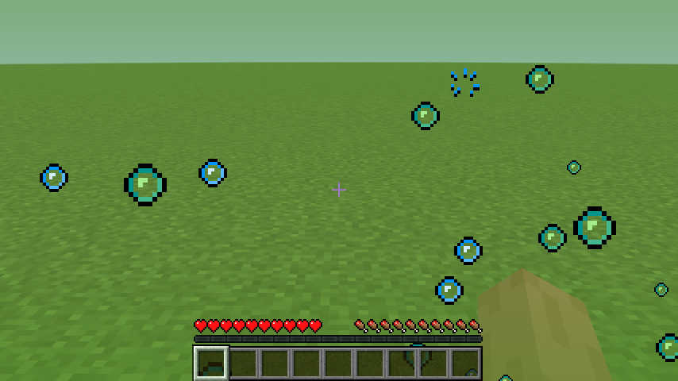 |

| Robot talking | Frog talking | Burger talking (its top bun is the mouth) |
|---|---|---|
| 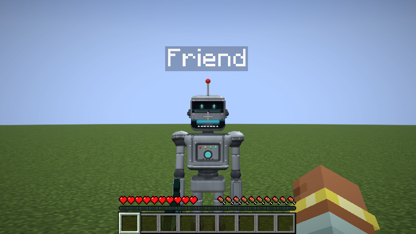 |  | 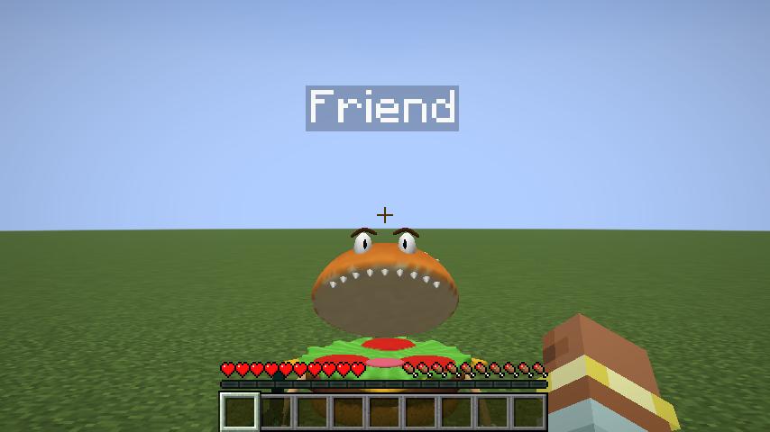 |

| Saying "fart" | | |
|---|---|---|
| 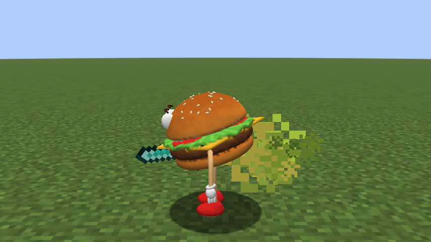 | 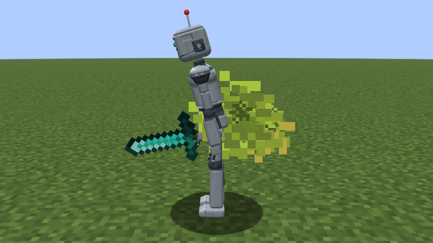 | 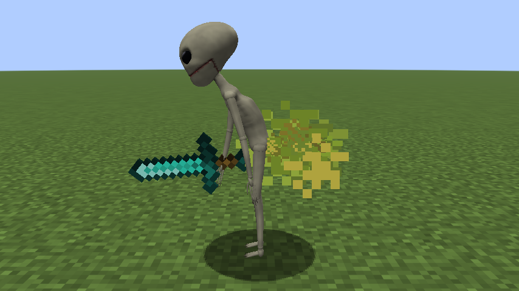 |

| Saying "fuck you" with a normal skin | Robot | Burger |
|---|---|---|
| 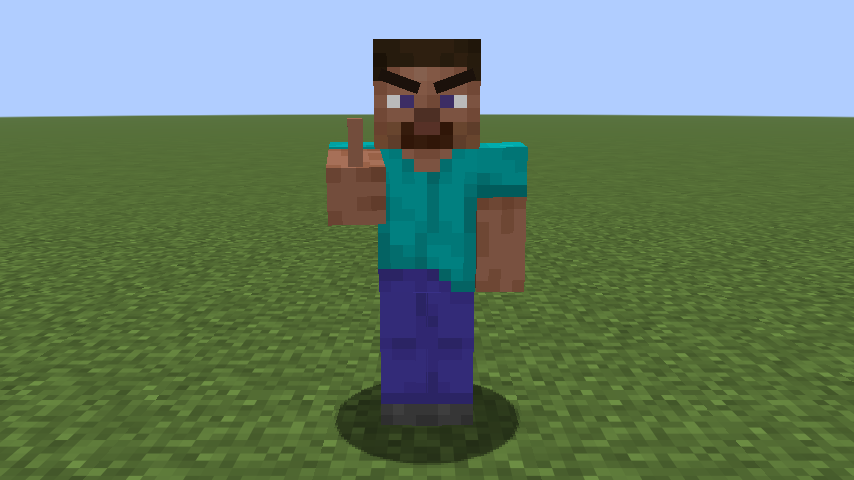 | 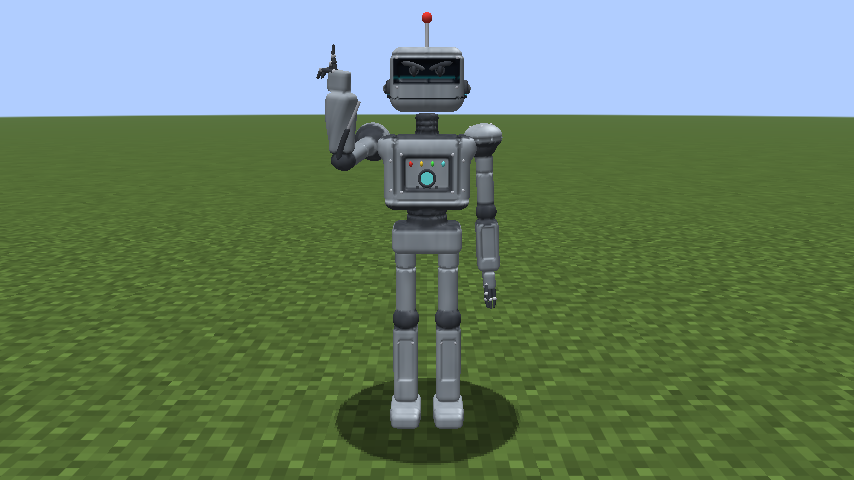 | 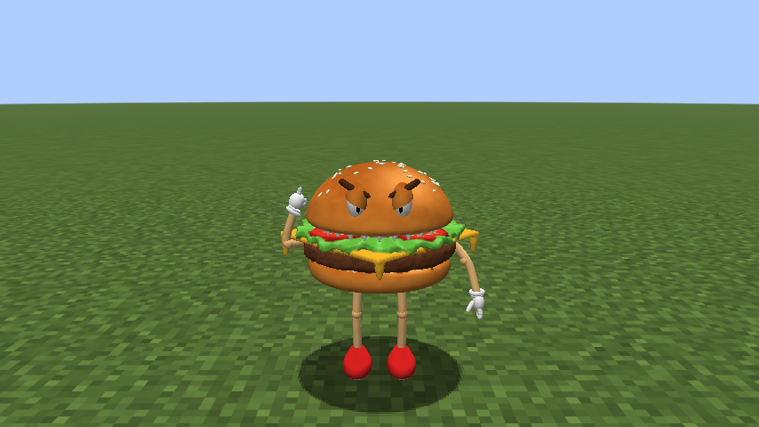 |

| Alien from the side, holding a sword | Normal player in armor | Same player as a skin character (armor hidden) |
|---|---|---|
| 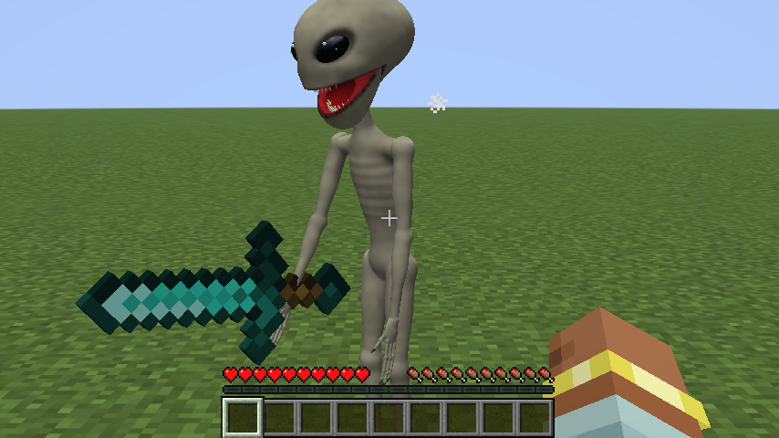 | 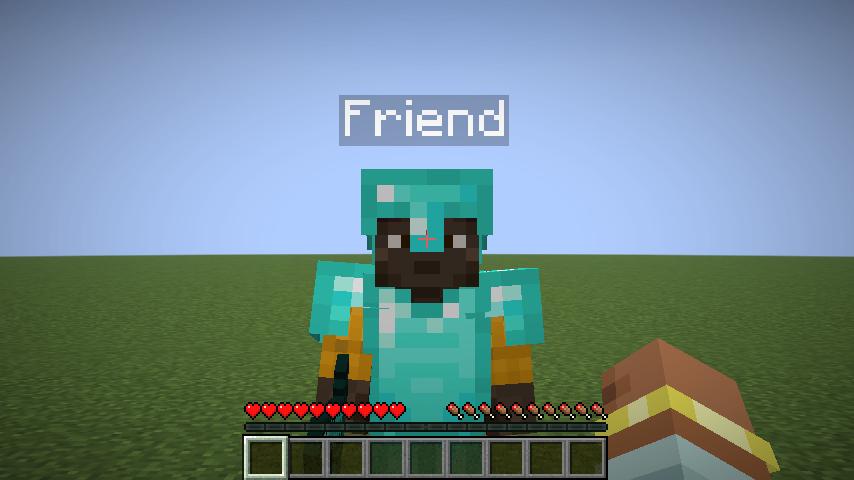 | 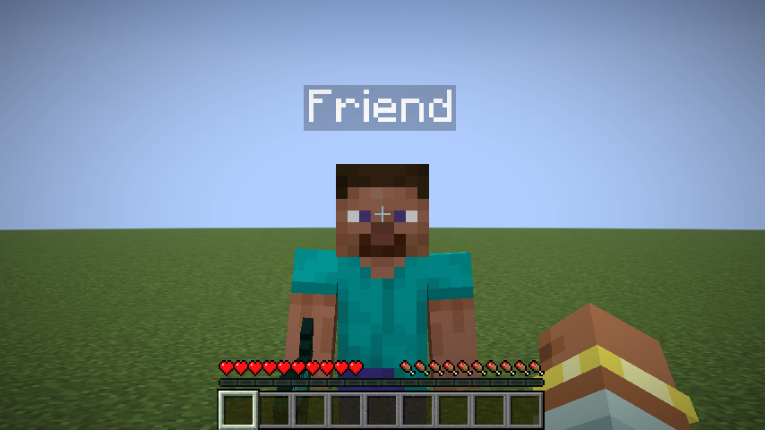 |

| Character menu (K) | Choosing a character | Key binds |
|---|---|---|
| 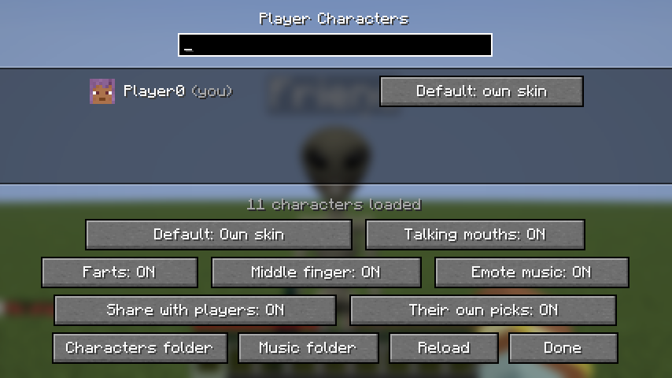 | 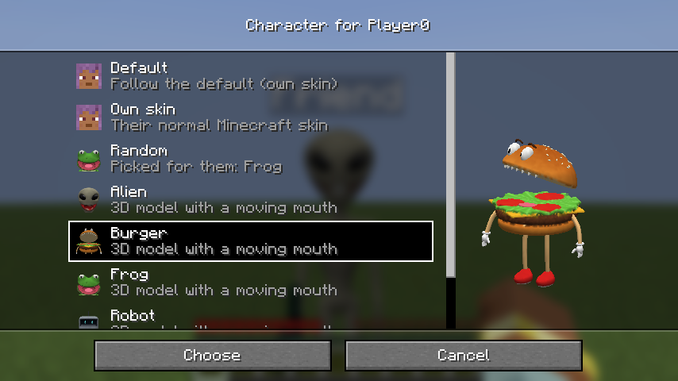 | 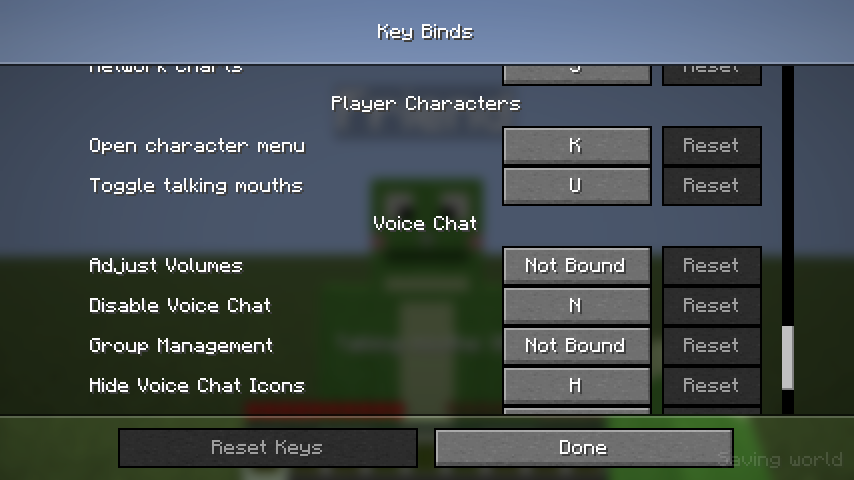 |

## Install

1. Install [Fabric Loader](https://fabricmc.net/use/) 0.20.1 or newer for Minecraft 1.21.11.
2. Put these in your `.minecraft/mods` folder:
   - `player-characters-5.0.0.jar` (this mod), from the [Releases page](https://github.com/itamarbleiberg/buti1/releases)
   - [Fabric API](https://modrinth.com/mod/fabric-api) for 1.21.11
   - [Simple Voice Chat](https://modrinth.com/plugin/simple-voice-chat) for Fabric 1.21.11 (needed for talking mouths
     and the voice emotes; the server must have Simple Voice Chat too, as usual)

The server does **not** need this mod. Characters are only shown on your screen: other players keep seeing
normal players unless they install the mod and set it up themselves.

The jar is about 58 MB because it contains an offline speech recognizer (see [Voice emotes](#voice-emotes)).

Remove older versions of `player-characters-*.jar` from the mods folder first: two versions of the same mod don't load.

## Use

| Key (default) | What it does |
|---|---|
| **K** | Open the character menu |
| **U** | Turn talking mouths on/off |

Change the keys in **Options > Controls > Key Binds > Player Characters**.

In the character menu:

- Every player on the server is listed (you are first). Click the button next to a player to pick their
  character. The picker shows your own player as the highlighted character, with its mouth opening and closing.
- **Default** decides what everyone you haven't picked for looks like: their own skin, a random character
  (each player always gets the same one), or one specific character.
- **Talking mouths** does the same as the U key.
- **Farts** and **Middle finger** turn the voice emotes on or off.
- **Characters folder** opens the folder with your characters. **Reload** loads new or changed files.

Your choices are saved in `.minecraft/config/playercharacters.json`.

## Voice emotes

- **"fart"**: the character bends over, a green cloud puffs out of its butt and you hear a fart.
- **"fuck you"** or **"fuck off"**: the character points its right arm at whoever is in front of it and shows the
  middle finger, puts away what it holds in that hand, and looks mad for about 3 seconds (angry eyebrows, and an angry
  cloud above its head). Players in a normal skin get a finger and eyebrows added to the Minecraft model.

This works for every character and for players shown in their own skin. Your own microphone counts too, and other
players who have the mod see it when they hear you. Typing the words in chat does the same.

In first person you see it too: your fist comes up in front of you with the middle finger pointing at whoever you look
at, and when you fart your screen turns green while gas bubbles float up and pop.

- The speech recognition is [Vosk](https://alphacephei.com/vosk/) with its small English model. It runs on your
  computer: no audio is sent anywhere, and it only hears the voices that Simple Voice Chat already plays for you.
- It listens for these phrases. The recognizers only know them and some words that sound like them ("far", "part",
  "farm", "thank you", "luck", "cough", "back off"...), so those aren't taken for them. There is one recognizer for
  farts and one for the middle finger, because adding "fuck off" to a single recognizer made it miss more farts.
  In a test with 372 computer-voiced sentences in six English accents, it caught "fart" in 32 of 36 and "fuck you" or
  "fuck off" in 72 of 72. The other sentences, with lookalikes such as "thank you so much", "back off" or "what the
  fuck", started one fart (of 336) and no middle finger (of 300). Real voices and noisy microphones may do worse.
- The first time someone talks, the model is unpacked to `.minecraft/playercharacters/speech-model` (47 MB). It
  uses about 90 MB of memory while it's on, plus a few MB per person talking. Turning both emotes off frees it.
- Vosk works on Windows (64-bit), macOS and Linux (64-bit). Where it can't start, the menu says "Fart detection
  unavailable" and typing the words in chat still works.

## Characters

Characters live in `.minecraft/config/playercharacters/characters/`. The mod puts eight 3D examples there (Alien,
Robot, Frog, Burger, Penguin, SpongeBob, Skinny Alien and 67, which is in the folder `Blue`) and a `README.txt` with the
details below. The penguin smokes: a thin line of smoke rises from its cigarette (except in your own first-person view,
where it would be right in front of your eyes).

Upgrading: examples from older versions are updated (version 5 turns Blue into 67 and remakes the Penguin, SpongeBob
and the Skinny Alien), and the version 2 skin Robot and Frog are replaced by the 3D ones. If you changed any file of an
example, that whole example is kept as it is, so a new model never gets old settings.
If a skin and a 3D folder have the same name, the 3D one is used and the menu tells you which file was skipped.

### 3D characters

A folder with a `model.obj`, like `Alien/`:

- `model.obj` (required): a Wavefront OBJ model, the format Blender and most 3D model sites can export.
  Use Y up, facing forward (+Z), 1 unit = 1 block. Split the model into objects named `head`, `jaw`, `body`,
  `right_arm`, `left_arm`, `right_leg` and `left_leg`. Each part moves like the same part of a normal player
  (walking, looking around, swinging, sneaking), and the `jaw` opens while the player talks.
  Objects with other names move with the body.
  For the middle finger emote (all optional): objects named `mad_head` (or `mad_jaw`, `mad_body`...) are only drawn
  while the character is mad, `calm_head` and so on only while it isn't, and `middle_finger` is a right arm making
  the gesture, used instead of `right_arm`. Model it hanging down like `right_arm`, with the finger pointing forward:
  the emote raises the arm forward, which turns the finger up.
- `texture.png` (optional): the texture. Without it, the model's vertex colors are used.
- `character.json` (optional): `name`, `height` (in blocks), `size` (scale), `turn` (degrees, if the model faces
  the wrong way), `jaw_angle` (degrees; negative opens the jaw upward like a lid, as the Burger's bun does),
  `butt` (where the fart cloud comes out), `waddle` (degrees it rocks from side to side while walking),
  `head_turn` (0 to 1: how much of the player's looking around the head copies), `smoke` (where smoke rises from,
  moving with the head, like the tip of the penguin's cigarette), and per-part `pivot` (the joint) and `hand` (where
  held items go).
  Without pivots, they're guessed from each part's size. A part can have a pivot without being in the model:
  the Burger has only a head pivot, so its bun turns with the head.
- `icon.png` (optional): picture for the menu.

The eight examples were made for this mod by [`tools/CharacterModels.java`](tools/CharacterModels.java), which
sculpts them from mathematical shapes, so they can be changed and rebuilt
(`java tools/CharacterModels.java <folder> [previewFolder] [name]`). The fart sounds are synthesized by
[`tools/make_fart_sounds.py`](tools/make_fart_sounds.py).

### Skin characters

- `Name.png`: a normal 64x64 Minecraft skin (old 64x32 skins work too). The file name is its name.
  Slim (3-pixel) arms are detected automatically.
- `Name_talking.png` (optional): the same skin with the mouth drawn open, shown while that player talks.
  Without it, the mod draws an open mouth on the face for you.
- `Name.json` (optional): `name`, `model` (`slim`/`wide`) and `mouth` (where the automatic mouth goes on the
  8x8 face, e.g. `{ "x": 1, "y": 5, "width": 6, "height": 2 }`).

## What gets hidden

For every character: armor, elytra, and heads or pumpkins worn on the head. For 3D characters also capes,
stuck arrows and bee stingers, which would float next to a differently shaped body. Name tags, the Simple Voice
Chat speaker icon, held items, parrots and riptide effects still show. In first person, a 3D character shows its own
arm instead of Minecraft's (while your hand is empty, like Minecraft's arm); skin characters show their skin on it.

## How it works

- `AvatarRendererMixin` records on each player's render state which character to draw, how open its jaw is and
  how far it is bent over.
- `LivingEntityRendererMixin` draws the 3D model instead of the player model (copying the player model's pose
  each frame), leaves out the armor layers, and moves the held-item layer's hands onto the character's hands so
  Minecraft's own item code still handles bows, shields, spears and so on.
- `AbstractClientPlayerMixin` swaps the skin for skin characters.
- `VoiceChatPlugin` is a Simple Voice Chat client plugin. It receives the audio of nearby players, group chat
  and your own microphone. `TalkTracker` opens the mouth on the loud parts of speech (syllables) and closes it in
  the quieter gaps, relative to how loud that person usually is, and `JawAnimator` moves 3D jaws there smoothly.
- `VoiceEmoteDetector` copies the same audio to its own thread, turns it into 16 kHz and runs two Vosk recognizers per
  person (one per emote), acting on their first guesses so the emote comes right after the words. `FartEffects` and
  `MiddleFingerEmote` play the emotes: `PlayerModelMixin` and `CharacterPoses` bend the upper body, raise the arm and
  make characters waddle, which 3D characters, held items and the normal player model all follow.
  `VanillaEmoteParts` adds the finger and eyebrows to the normal player model.
- In first person, `AvatarRendererMixin` swaps in a 3D character's own arm, `ItemInHandRendererMixin` and
  `FirstPersonHands` raise the middle finger in front of the camera, and `FartScreen` is a HUD layer with the green
  screen and its bubbles. `CigaretteSmoke` puts smoke particles at the tip of the penguin's cigarette, following its
  head.
- Without Simple Voice Chat installed, the mod still works; mouths just don't move, and only typed emotes work.

Other mods that replace the player model (Figura, Entity Model Features and similar) may not work together with
this one.

## Building from source

Gradle must run on **Java 25** (required by Fabric Loom 1.19); the mod itself targets Java 21 like Minecraft 1.21.11.

```
./gradlew build
```

The jar ends up in `build/libs/`. The first build downloads the speech model from alphacephei.com and checks its
SHA-256 (task `prepareSpeechModel`).

`./gradlew runClientGameTest` starts the game, creates a world and checks the mod end to end (the example
characters, a skin character on another player in armor, talking jaws, farts and middle fingers typed in chat, the
penguin's smoke, your own arm, middle finger and green screen in first person, both keys, the menus, upgrading folders
from versions 2, 3 and 4), saving screenshots to
`build/run/clientGameTest/screenshots/`. If Simple Voice Chat is added to the test game, it also plays real voice
chat audio and checks that mouths react to it, and with recorded sentences
(`-Dplayercharacters.test.speechClips=<folder>`) that saying "fart", "fuck you" and "fuck off" works and lookalikes
don't.

## License notes

The mod jar includes Vosk and its small English model, both under the Apache License 2.0. See
[`THIRD_PARTY_NOTICES.md`](THIRD_PARTY_NOTICES.md).
