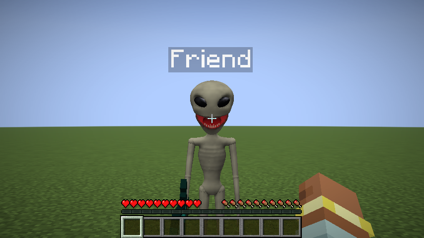

# Player Characters

A client-side Fabric mod for **Minecraft 1.21.11**. It shows players on a server as characters you choose: real
3D models (like the included alien) or skins you make yourself. The character's mouth opens while that player
talks in [Simple Voice Chat](https://modrinth.com/plugin/simple-voice-chat).

While a player is shown as a character, you don't see their armor, but you still see their name tag and the item
they're holding.

| Quiet | Talking | From the side, holding a sword |
|---|---|---|
|  |  |  |

| Normal player in armor | Same player as a skin character (armor hidden) | Skin character talking |
|---|---|---|
|  |  |  |

| Character menu (K) | Choosing a character | Key binds |
|---|---|---|
|  |  |  |

## Install

1. Install [Fabric Loader](https://fabricmc.net/use/) 0.20.1 or newer for Minecraft 1.21.11.
2. Put these in your `.minecraft/mods` folder:
   - `player-characters-2.0.0.jar` (this mod), from the [Releases page](https://github.com/itamarbleiberg/buti1/releases)
   - [Fabric API](https://modrinth.com/mod/fabric-api) for 1.21.11
   - [Simple Voice Chat](https://modrinth.com/plugin/simple-voice-chat) for Fabric 1.21.11 (needed for the talking mouths;
     the server must have Simple Voice Chat too, as usual)

The server does **not** need this mod. Characters are only shown on your screen: other players keep seeing
normal players unless they install the mod and set it up themselves.

## Use

| Key (default) | What it does |
|---|---|
| **K** | Open the character menu |
| **U** | Turn talking mouths on/off |

Change the keys in **Options > Controls > Key Binds > Player Characters**.

In the character menu:

- Every player on the server is listed (you are first). Click the button next to a player to pick their
  character. The picker shows your own player as the highlighted character, with its mouth opening and closing.
- **Default** decides what everyone you haven't picked for looks like: their own skin, a random character
  (each player always gets the same one), or one specific character.
- **Talking mouths** does the same as the U key.
- **Characters folder** opens the folder with your characters. **Reload** loads new or changed files.

Your choices are saved in `.minecraft/config/playercharacters.json`.

## Characters

Characters live in `.minecraft/config/playercharacters/characters/`. The mod puts three examples there
(Alien, Robot and Frog) and a `README.txt` with the details below.

### 3D characters

A folder with a `model.obj`, like `Alien/`:

- `model.obj` (required): a Wavefront OBJ model, the format Blender and most 3D model sites can export.
  Use Y up, facing forward (+Z), 1 unit = 1 block. Split the model into objects named `head`, `jaw`, `body`,
  `right_arm`, `left_arm`, `right_leg` and `left_leg`. Each part moves like the same part of a normal player
  (walking, looking around, swinging, sneaking), and the `jaw` opens while the player talks.
  Objects with other names move with the body.
- `texture.png` (optional): the texture. Without it, the model's vertex colors are used.
- `character.json` (optional): `name`, `height` (in blocks), `size` (scale), `turn` (degrees, if the model faces
  the wrong way), `jaw_angle` (degrees), and per-part `pivot` (the joint) and `hand` (where held items go).
  Without pivots, they're guessed from each part's size.
- `icon.png` (optional): picture for the menu.

The Alien was made for this mod by [`tools/AlienGenerator.java`](tools/AlienGenerator.java), which sculpts it
from mathematical shapes, so it can be changed and rebuilt (`java tools/AlienGenerator.java <folder>`).

### Skin characters

- `Name.png`: a normal 64x64 Minecraft skin (old 64x32 skins work too). The file name is its name.
  Slim (3-pixel) arms are detected automatically.
- `Name_talking.png` (optional): the same skin with the mouth drawn open, shown while that player talks.
  Without it, the mod draws an open mouth on the face for you.
- `Name.json` (optional): `name`, `model` (`slim`/`wide`) and `mouth` (where the automatic mouth goes on the
  8x8 face, e.g. `{ "x": 1, "y": 5, "width": 6, "height": 2 }`).

## What gets hidden

For every character: armor, elytra, and heads or pumpkins worn on the head. For 3D characters also capes,
stuck arrows and bee stingers, which would float next to a differently shaped body. Name tags, the Simple Voice
Chat speaker icon, held items, parrots and riptide effects still show. In first person you keep seeing your
normal arm.

## How it works

- `AvatarRendererMixin` records on each player's render state which character to draw and how open its jaw is.
- `LivingEntityRendererMixin` draws the 3D model instead of the player model (copying the player model's pose
  each frame), leaves out the armor layers, and moves the held-item layer's hands onto the character's hands so
  Minecraft's own item code still handles bows, shields, spears and so on.
- `AbstractClientPlayerMixin` swaps the skin for skin characters.
- `VoiceChatPlugin` is a Simple Voice Chat client plugin. It receives the audio of nearby players, group chat
  and your own microphone. `TalkTracker` opens the mouth on the loud parts of speech (syllables) and closes it in
  the quieter gaps, relative to how loud that person usually is, and `JawAnimator` moves 3D jaws there smoothly.
- Without Simple Voice Chat installed, the mod still works; mouths just don't move.

Other mods that replace the player model (Figura, Entity Model Features and similar) may not work together with
this one.

## Building from source

Gradle must run on **Java 25** (required by Fabric Loom 1.19); the mod itself targets Java 21 like Minecraft 1.21.11.

```
./gradlew build
```

The jar ends up in `build/libs/`.

`./gradlew runClientGameTest` starts the game, creates a world and checks the mod end to end (example
characters, the 3D alien and skin characters on another player in armor, talking jaws, both keys, the menus),
saving screenshots to `build/run/clientGameTest/screenshots/`. If Simple Voice Chat is added to the test game, it
also plays real voice chat audio and checks that mouths react to it.
